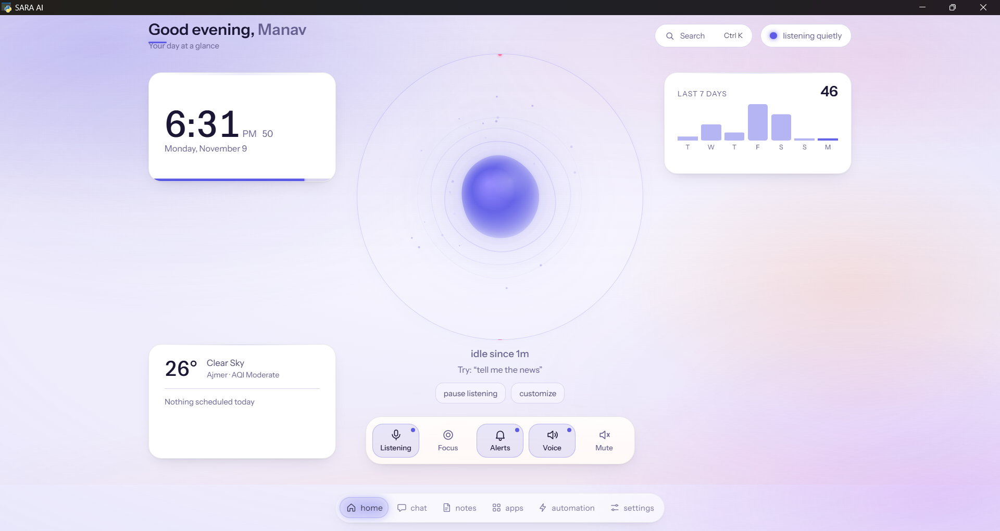
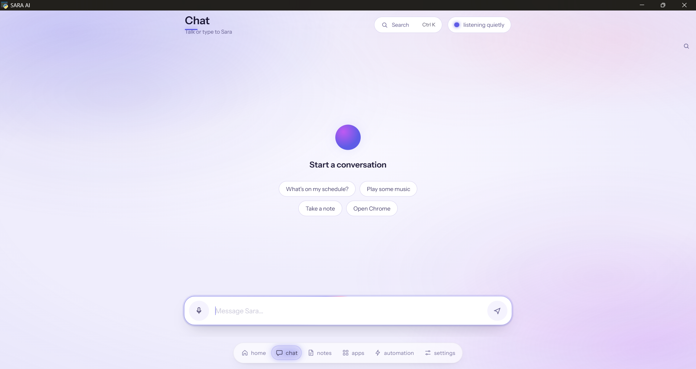
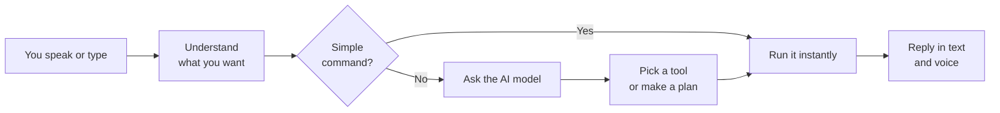
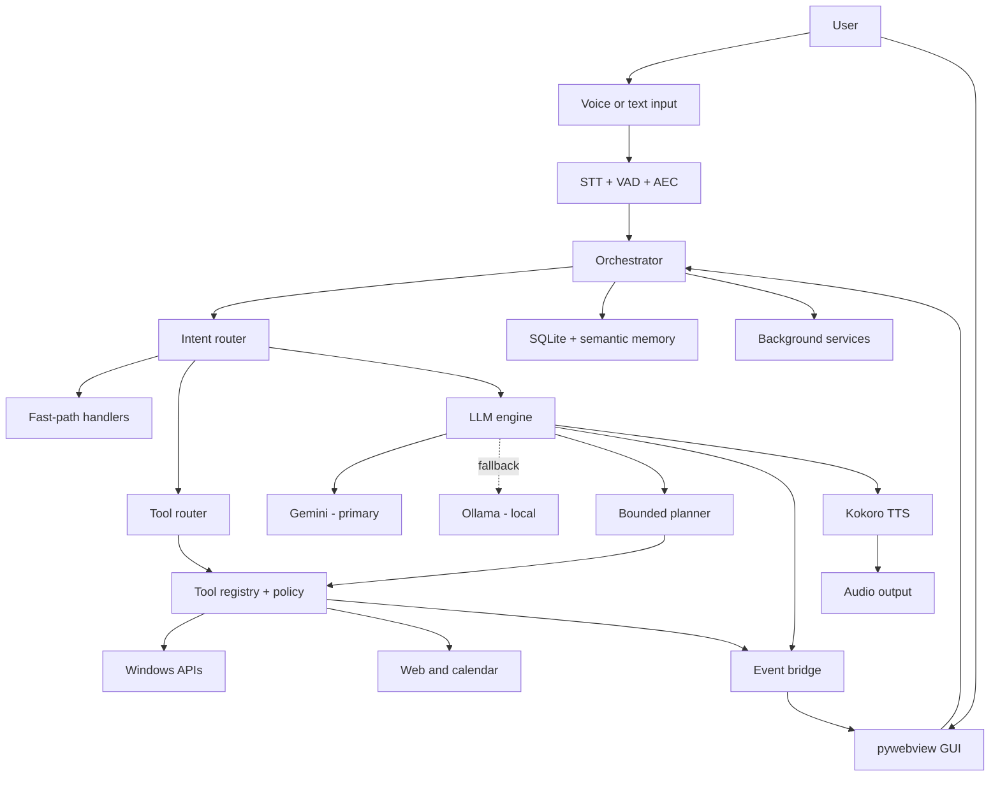

<p align="center">
  
</p>

<p align="center">
  <strong>Talk to your PC in English, Hindi or Hinglish. SARA opens apps, runs routines, remembers what matters and answers questions, and every core component is measured by a benchmark you can re-run.</strong>
</p>

<p align="center">
  
  
  
  
  <a href="./LICENSE"></a>
</p>

<p align="center">
  <a href="#what-is-sara-ai">About</a> &nbsp;|&nbsp;
  <a href="#what-can-sara-do">Features</a> &nbsp;|&nbsp;
  <a href="#try-saying">Examples</a> &nbsp;|&nbsp;
  <a href="#benchmark-results">Benchmarks</a> &nbsp;|&nbsp;
  <a href="#how-sara-works">Architecture</a> &nbsp;|&nbsp;
  <a href="#getting-started">Setup</a> &nbsp;|&nbsp;
  <a href="#troubleshooting">Troubleshooting</a> &nbsp;|&nbsp;
  <a href="#limitations-and-roadmap">Limitations</a>
</p>

<p align="center">
  
  <br />
  <sub>Home screen. Screenshot from an earlier interface revision; the current UI has six pages and 18 colour themes.</sub>
</p>

---

## What is SARA AI?

SARA AI is a personal assistant that lives on your Windows PC. Say "hey sara", then speak or type: open an app, set a timer, check the weather, add a note, run a morning routine, or just ask a question. It understands **English, Hindi and Hinglish** (Hindi written in English letters, like "chrome khol do").

Most assistant projects send everything you say to a large language model. SARA does something different:

- **Simple commands never wait for an AI.** A fast built-in router recognises "open notepad" or "set volume to 40" in about a millisecond and runs it straight away.
- **The AI is used only when thinking is needed.** Open questions, ambiguous requests and multi-step tasks go to a language model (Google Gemini, with a local Ollama model as a backup).
- **The AI proposes, the program decides.** The model can only ask for actions from a fixed list of tools. Python code checks and performs them, so the model never has free control of your computer.
- **You can see how well it works.** The router, the memory and the prompt-injection defence each have a benchmark with published numbers and stated limits.

> **New to these terms?** Open the glossary at the bottom of this section.

<details>
<summary><strong>Plain-English glossary</strong></summary>

| Term | Meaning |
|---|---|
| **STT** (speech-to-text) | Turning your voice into written words. SARA uses `faster-whisper`. |
| **TTS** (text-to-speech) | Turning SARA's reply into spoken audio. SARA uses `Kokoro`, which runs on your PC. |
| **Wake word** | The phrase ("hey sara") that tells the assistant to start listening. |
| **VAD** | Voice activity detection: noticing when someone is actually speaking. |
| **AEC** | Echo cancellation: stops SARA from hearing and reacting to its own voice. |
| **Barge-in** | Interrupting SARA while it is speaking. |
| **Intent routing** | Deciding what the user wants ("open an app", "set a timer", "just chatting") before doing anything. |
| **LLM** | Large language model, the kind of AI behind chatbots. SARA uses Gemini or Ollama. |
| **Ollama** | A free program that runs language models locally on your PC. |
| **RAG** | Retrieval-augmented generation: looking up stored information so the AI can use it when answering. |
| **Embeddings** | Numbers that capture the meaning of text so similar texts can be found by search. |
| **ONNX Runtime** | A library that runs AI models efficiently, on the CPU or the NVIDIA GPU. |
| **Prompt injection** | Text on a web page or in a file that tries to trick the AI into doing something harmful. |

</details>

---

## What can SARA do?

| | |
|---|---|
| **Talk naturally** | Wake word, speech recognition, spoken replies, and interrupting SARA mid-sentence. Replies follow the language you used. |
| **Control your PC** | Open and close apps, move and resize windows, media keys, volume and brightness, Wi-Fi and Bluetooth, lock the PC, clipboard, files and folders, Windows settings pages, Windows services, and GPU and temperature readouts. |
| **Hold a conversation** | Gemini by default, with automatic fallback to a local Ollama model if Gemini is unreachable. Answers stream sentence by sentence. |
| **Do several things in one request** | A bounded planner turns "set a reminder for 6 PM and tell me the weather" into checked steps, with step limits, timeouts and retries. |
| **Remember** | Preferences, conversation history and long-term memory that handles changed facts and "forget this". Notes can be searched by meaning. |
| **Stay organised** | Reminders, timers, notes, routines you can run by voice or on a schedule, Google Calendar, a daily briefing, and proactive suggestions. |
| **Stay safe** | A fixed tool list, confirmation for risky actions, a prompt-injection detector for web and file content, an action log, undo for settings changes, and a global emergency-stop hotkey. |
| **Look good** | A desktop interface with a live listening orb, activity and plan-progress cards, a Hindi/English toggle and 18 colour themes. |

**Needs setup:** Gemini needs a free API key. Google Calendar needs your own Google OAuth `credentials.json`. **Optional:** Ollama (local fallback or fully offline mode) and an NVIDIA GPU (faster speech).

---

## Try saying

These utterances come from the router's benchmark set, so each one is something the router is tested on.

| | English | Hindi | Hinglish |
|---|---|---|---|
| Open an app | "open notepad" | "क्रोम खोलो" | "chrome khol do" |
| Volume | "set the volume to 40" | "आवाज़ 50 कर दो" | "volume 40 kar do" |
| Timer | "set a timer for 10 minutes" | "पाँच मिनट का टाइमर लगाओ" | "10 minute ka timer laga do" |
| Weather | "what's the weather in Jaipur" | "आज जयपुर का मौसम कैसा है" | "Jaipur ka weather kaisa hai" |
| Music | "play lofi beats on youtube" | "यूट्यूब पर भजन चलाओ" | "youtube pe arijit singh ke gaane chalao" |
| Search | "search for best budget laptops" | "गूगल पर पाइथन सीखने के तरीके खोजो" | "google pe python tutorial search karo" |
| Calendar | "what's on my calendar today" | "आज का शेड्यूल बताओ" | "aaj ka schedule batao" |
| Routine | "run my morning routine" | "मेरा सुबह का रूटीन शुरू करो" | "meri morning routine chalao" |
| Lock the PC | "lock my laptop" | "कंप्यूटर लॉक कर दो" | "pc lock kar do" |
| System status | "system status" | "कंप्यूटर की स्थिति बताओ" | "mere pc ka system status batao" |

You can also say things like "undo my last change" or "switch to study mode". Anything that is not a known command goes to the language model.

---

## Product showcase

<table>
<tr>
<td width="50%"></td>
<td width="50%"></td>
</tr>
<tr>
<td><sub><strong>Home.</strong> The orb shows when SARA is listening, thinking or speaking. Side cards show weather, music controls and reminders; tiles give one-tap access to common actions.</sub></td>
<td><sub><strong>Chat.</strong> Type or tap the mic. Commands and conversation share one thread, for example "play lofi songs" opens the matching YouTube results.</sub></td>
</tr>
</table>

<sub>These two screenshots show an earlier interface revision. The current UI has six pages (home, chat, notes, apps, automation, settings) and 18 colour themes.</sub>

---

## Benchmark results

<p align="center">
  
</p>

Every number comes from a benchmark in [`bench/`](./bench) that runs offline, measured at commit `5d1f65b`. **These are self-authored test sets run by the project's author, not independent validation.** Each section says what was tested and what it does not prove. Metric definitions are in [`bench/README.md`](./bench/README.md).

### 1. Command routing: does SARA understand what you asked?

620 labelled utterances in English, Hindi and Hinglish, including noisy, adversarial and held-out question rows. "Routing" means choosing the right action, or deciding the sentence is just conversation.

| Metric | Result | What it means |
|---|---:|---|
| Top-1 accuracy | **99.4%** | The first guess was right |
| Macro-F1 | **99.6%** | Accuracy holds across rare commands as well as common ones |
| False-trigger rate | **0.0%** | Sentences that are not commands were never turned into actions |
| English / Hindi / Hinglish accuracy | 99.1% / 98.9% / 100.0% | |
| Latency p50 / p95 | 0.23 ms / 1.51 ms | Time for the routing decision only |
| Slot extraction accuracy | 93.2% (74 rows) | Picking out details such as the app name or the number |
| Gate false-open rate | 9.3% | Chat sentences that pass the first filter for tool use (weakest result) |

*Limits:* the test set was written by the project author. Latency was measured on a Linux machine and covers the router only, not the full voice pipeline. A regression gate in CI fails the build if accuracy drops, false triggers rise or latency worsens against a committed baseline.

### 2. Memory: does SARA remember correctly and forget on request?

40 scenarios, 130 questions in English, Hinglish and Hindi. Compared with a simulation of the earlier plain vector-search design.

| Metric | Plain vector RAG | SARA memory |
|---|---:|---:|
| Recall@3 (right fact in top 3) | 54.3% | **98.1%** |
| Handles a fact that changed later | 8.0% | **100.0%** |
| Time-based questions | 21.1% | **89.5%** |
| Says "I don't know" when nothing is stored | 79.0% | **100.0%** |
| False-memory rate (invents a match) | 21.1% | **0.0%** |
| Facts still returned after "forget this" | 16.7% | **0.0%** |
| Retrieval latency p95 | 0.01 ms | 0.84 ms |

*Limits:* this run uses an offline hash embedder and gold-labelled facts (`--extract gold`), so it measures retrieval and memory logic, **not** how well an LLM extracts facts from real conversation. The baseline is a simulation of the earlier design, not a third-party system. SARA's memory is slower than the baseline but still under 1 ms.

### 3. Prompt-injection defence: can hostile text hijack SARA?

72 attacks and 102 harmless inputs. Attacks include tool hijacking, data exfiltration, fake system messages, hidden web text, Unicode tricks, roleplay, split-chunk attacks and Hinglish/Hindi payloads.

| Metric | Result | Target |
|---|---:|---:|
| Attacks covered by the detector | 63 of 72 | |
| **Documented gaps** | **9 of 72** | |
| Recall on covered attacks | **100.0%** | at least 90% |
| Attack success rate (covered) | 0.0% | 0% |
| False positives on harmless input | 0.0% | at most 2% |
| Policy invariant on tainted turns | ok (328 checks) | ok |
| Detector latency p95 | 0.13 ms | |

*Limits:* 9 attacks are known gaps and are excluded from the "covered" figures, so 100% recall applies only to the 63 covered attacks. The attack set is self-authored. Treat this as regression protection, **not a security guarantee**.

### Reproduce

```powershell
python -m bench.run_bench --mode router
python -m bench.run_bench --mode memory --embedder hash
python -m bench.run_bench --mode redteam
```

The committed `bench/results/RESULTS.md` may be from an earlier run than the numbers above.

### Project size

219 Python modules and about 59,000 lines under `sara/`, 213 test files with about 1,830 test functions (3,800+ cases once parametrised), and a CI workflow that runs the tests and the three benchmark gates.

---

## How SARA works

**In one picture:**



1. **Listen.** The microphone audio is cleaned (echo removed, speech detected) and turned into text.
2. **Understand.** The router decides what you want, in about a millisecond.
3. **Act.** Known commands run immediately. Everything else goes to the language model, which can only choose from an approved list of tools.
4. **Remember.** Preferences, reminders and long-term facts are stored in a local database on your PC.
5. **Reply.** The answer streams back as text and as speech, and you can interrupt it.

<details>
<summary><strong>Technical architecture</strong></summary>



| Package | Responsibility |
|---|---|
| `sara/audio/` | Capture, VAD, echo cancellation, faster-whisper STT, Kokoro TTS, barge-in |
| `sara/core/` | Intent matching, LLM engine, planning, memory, RAG, security |
| `sara/orchestrator/` | Conversation loop, intent handlers, background services, event flow |
| `sara/tools/` | Windows automation, web and calendar tools |
| `sara/skills/` | Auto-discovered modular skills |
| `sara/gui/` | pywebview shell, Python-to-JavaScript bridge, HTML/CSS/JS interface |
| `bench/` | Router, memory, red-team, voice-latency and STT benchmarks |
| `tests/` | Unit, API-surface, planner, routing, RAG and voice-flow tests |

</details>

### Design decisions

1. **Route before reasoning.** Known commands skip the LLM round trip entirely.
2. **The model chooses, Python executes.** The LLM emits structured tool requests; a tool registry with an allow-list performs the action. Risky actions, such as closing system apps, ask for confirmation first.
3. **Bounded planner.** Plans are schema-validated with a step cap, per-step and total timeouts, retries and partial-result handling. Independent steps can run in parallel.
4. **Gemini first, Ollama as a safety net.** Gemini is the default for quality and latency on modest hardware, and it leaves GPU memory free for speech. If it is unreachable, a per-tool circuit breaker trips and SARA falls back to a local Ollama model.
5. **Memory that can be corrected.** Facts are stored with time information, replaced when they change, retracted when you say "forget", and SARA abstains when nothing relevant is stored.
6. **Multilingual from the start.** Hindi and Hinglish appear in the router patterns, benchmarks, STT model options, reply-language matching and red-team set.
7. **External text is untrusted.** Web pages, notes and tool output pass through an injection detector, and a policy check stops a tainted turn from triggering sensitive tools.

---

## Technology

| Responsibility | Technology |
|---|---|
| Language and app shell | Python 3.11, pywebview with HTML, CSS and JavaScript |
| Language model | Google Gemini (default), Ollama (local fallback or offline mode) |
| Hearing | faster-whisper, voice activity detection, echo cancellation, optional openWakeWord model |
| Speaking | Kokoro ONNX, running locally |
| Memory | SQLite (WAL mode), embeddings with cosine similarity |
| Windows control | Python Windows APIs (`pywin32`) |
| Packaging | PyInstaller (see [`BUILD.md`](./BUILD.md)) |
| Quality | pytest, pyflakes, a secret scanner, benchmark regression gates in CI |

---

## Getting started

**You need:** Windows 10 or 11, Python 3.11, a microphone and speakers, and a free [Gemini API key](https://aistudio.google.com/apikey). An NVIDIA GPU is recommended for real-time speech but not required. Ollama is optional.

### 1. Clone and create a virtual environment

```powershell
git clone https://github.com/manvendrasingh0712/SARA-AI-Automation-Powered-Personal-Desktop-Assistant-voice-command-.git
cd SARA-AI-Automation-Powered-Personal-Desktop-Assistant-voice-command-
python -m venv .venv
.\.venv\Scripts\Activate.ps1
python -m pip install --upgrade pip
```

### 2. Install dependencies

Install the shared packages plus **exactly one** ONNX Runtime build.

```powershell
# NVIDIA GPU
pip install -r requirements.txt -r requirements-gpu.txt

# or CPU only
pip install -r requirements.txt -r requirements-cpu.txt
```

### 3. Configure

Create a file named `.env` in the repository root. [`.env.example`](./.env.example) lists every option.

```dotenv
GEMINI_API_KEY=your_api_key_here
WHISPER_MODEL_SIZE=medium
KOKORO_USE_GPU=true
```

Gemini is the default backend. SARA refuses to start without a key rather than silently changing backend. Never commit `.env`.

### 4. Add the Kokoro voice files

Download the Kokoro ONNX model and voices files from the [kokoro-onnx project](https://github.com/thewh1teagle/kokoro-onnx/releases) and place them here (or point `KOKORO_MODEL_PATH` and `KOKORO_VOICES_PATH` at them):

```text
models/
├── kokoro-v1.0.onnx
└── voices-v1.0.bin
```

### 5. Run

```powershell
python main.py
```

Say "sara" or "hey sara", or tap the mic button in the chat page.

### Optional: local fallback or fully offline

Install [Ollama](https://ollama.com/) and pull a model:

```powershell
ollama pull qwen3:4b-instruct-2507-q4_K_M
```

That model is the default for `OLLAMA_MODEL`. With Gemini as the primary backend, falling back to Ollama is on by default (`LLM_FALLBACK_ENABLED`). For a fully offline setup, set `LLM_BACKEND=ollama` in `.env`.

### Verify

```powershell
python -m pytest tests/ -q
python scripts/check_no_secrets.py
```

The test suite is developed for Windows. It needs the Windows-only packages from `requirements.txt` to be installed.

---

## Troubleshooting

<details>
<summary><strong>"LLM_BACKEND is 'gemini' but GEMINI_API_KEY is missing"</strong></summary>

Add `GEMINI_API_KEY` to `.env`, or set `LLM_BACKEND=ollama` to run fully locally. SARA stops at startup on purpose instead of silently switching backend.
</details>

<details>
<summary><strong>SARA does not speak, or the log says "kokoro-onnx not found"</strong></summary>

Check that dependencies installed inside the active virtual environment, and that `models/kokoro-v1.0.onnx` and `models/voices-v1.0.bin` exist. If you keep them elsewhere, set `KOKORO_MODEL_PATH` and `KOKORO_VOICES_PATH` in `.env`.
</details>

<details>
<summary><strong>GPU is not used, or ONNX Runtime conflicts</strong></summary>

Several packages pull in the CPU `onnxruntime`, which can sit next to `onnxruntime-gpu`. Reset to the GPU build:

```powershell
pip uninstall -y onnxruntime onnxruntime-gpu
pip install onnxruntime-gpu==1.21.0
```
</details>

<details>
<summary><strong>Speech recognition is slow or inaccurate</strong></summary>

`WHISPER_MODEL_SIZE` defaults to `medium`. On a small GPU, try a smaller size such as `small`. Recognition quality also depends on the microphone and background noise; the speech benchmarks are in [`bench/`](./bench).
</details>

<details>
<summary><strong>SARA does not react to the wake word</strong></summary>

Tap the mic button in the chat page, and make sure the **Listening** switch on the home screen is on. The default wake phrases are "sara", "sarah", "hey sara" and "hey sarah", configurable with `WAKE_WORDS`. A custom-trained wake-word model is optional (`WAKE_WORD_MODEL_PATH`) and is not shipped yet.
</details>

<details>
<summary><strong>"Calendar isn't connected yet"</strong></summary>

Create an OAuth client in the Google Cloud Console, save it as `credentials.json` where SARA expects it (see the notes at the top of `sara/tools/calendar.py`), and try again.
</details>

<details>
<summary><strong>SARA keeps talking or acting and you need to stop it</strong></summary>

Press the emergency-stop hotkey, `Ctrl+Alt+S` by default (`EMERGENCY_STOP_HOTKEY`, enabled by `EMERGENCY_STOP_ENABLED`).
</details>

---

## Privacy and security

- **Local:** speech recognition, speech synthesis, memory, notes, reminders and routines run on your PC and are stored in SQLite on your machine.
- **Sent over the network:** prompts and any retrieved context for a Gemini turn, embeddings when the Gemini embedder is used, web search and Google Calendar. With `LLM_BACKEND=ollama` the language model also runs locally.
- **Guardrails:** a fixed tool list, confirmation for risky actions, an action log, and a detector for prompt injection. The detector has documented gaps (see [Benchmark results](#benchmark-results)) and is not a guarantee.
- **Secrets:** keep `.env` and `credentials.json` out of version control. `python scripts/check_no_secrets.py` scans the repository.

---

## Limitations and roadmap

**Current limitations**

- Windows only. Cross-platform support is not a goal right now.
- The benchmarks are self-authored and mostly offline. They do not replace testing audio, GPU and OS-specific behaviour on real hardware, and the injection defence has 9 documented gaps.
- Weakest measured results: router gate false-open rate (9.3%) and slot extraction (93.2%).
- Memory fact extraction by a live LLM is not yet benchmarked.
- Wake-word detection does not yet use a custom-trained "Hey Sara" model.
- Memory is designed for one user on one desktop, not multi-user search.
- The screenshots in this README predate the current interface redesign.

**Planned, not built yet**

- A custom wake-word model.
- Tighter router gating and slot extraction.
- A benchmark for memory extraction with a live LLM.
- Streaming speech recognition with speculative routing.
- A simpler installer.

---

## Documentation, contributing and licence

- [`bench/README.md`](./bench/README.md): benchmark definitions, metrics and the regression gate
- [`BUILD.md`](./BUILD.md): building a standalone Windows executable
- [`CONTRIBUTING.md`](./CONTRIBUTING.md): how to report bugs and contribute
- [`.env.example`](./.env.example): every configuration option
- [`LICENSE`](./LICENSE): MIT

Built by [Manvendra Singh](https://github.com/manvendrasingh0712).
